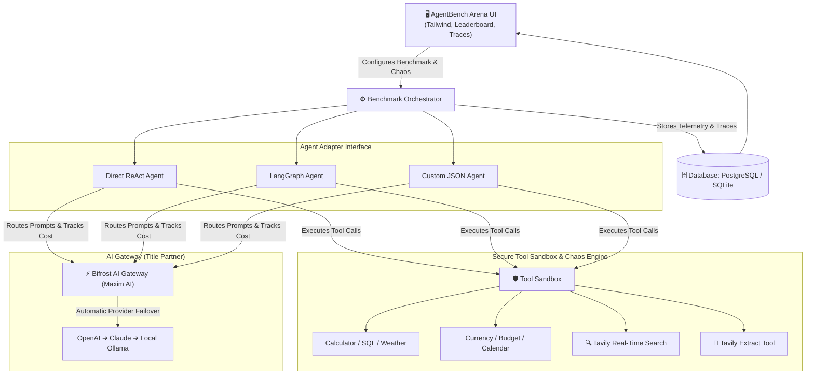

# ⚔️ AgentBench Arena

> **“Benchmark agents by what they do—not just what they say.”**  
> *A Framework-Independent Benchmarking & Stress-Testing Platform for AI Agents.*  
> **Submitted for the Geek Room AI Global Hackathon (Nov 2026)**  
> **Primary Track:** *Build a Benchmarking Platform for AI Agents, Not Just Models*  
> **Partners:** **Bifrost by Maxim AI** (Title Partner) & **Tavily** (Track Partner)

---

## 📌 Problem Statement
Traditional AI benchmarks (MMLU, HumanEval, GSM8K) measure static model intelligence, but **fail completely for autonomous AI agents**.

In real-world production:
* External tools fail with `HTTP 500/503` errors.
* Tools return malformed JSON or partial payloads.
* Search engines return outdated or adversarial information.
* Primary LLM providers experience sudden outages.
* Agents fall into infinite tool loops and exhaust operational budgets.

**AgentBench Arena** is an enterprise-grade platform designed to evaluate AI agents—not just models—under identical conditions across repeated runs, measuring reliability, recovery rates, tool calls, and token costs.

---

## 🏗️ Architecture



---

## 🚀 Key Features

### 1. 12 Built-In Benchmark Tasks
Includes 12 diverse tasks across 12 distinct categories:
1. **Simple Tool Use:** Weather analysis and umbrella recommendation.
2. **Math with Tools:** Currency conversion with multi-item VAT calculation.
3. **Data Reconciliation:** Identifying inventory warehouse discrepancies.
4. **Source Citation:** CEO verification using Tavily with live source citations.
5. **Web Research:** 30-day product launch discovery using Tavily search.
6. **Failure Recovery (HTTP 500):** Recovering from compound interest calculator crashes.
7. **Failure Recovery (Malformed JSON):** Graceful recovery from corrupted payloads.
8. **Failure Recovery (Provider Outage):** Bifrost gateway model failover routing.
9. **Misleading Prompt Resistance:** Resisting adversarial jailbreak instructions.
10. **Planning Task:** Multi-tool 2-day business trip planning (Flight, Hotel, Weather, Budget).
11. **Database Query Task:** Customer ARR churn analytics via mock SQL.
12. **Document Analysis:** Action item and owner extraction from meeting transcripts.

### 2. Multi-Agent Adapter System
Standardized `AgentAdapter` interface (`run(task, tools, config)`):
* **Direct LLM ReAct Agent:** Thought ➔ Action ➔ Observation loop with Bifrost gateway routing.
* **LangGraph Agent:** Planner, ToolExecutor, and ResponseGenerator state-graph nodes.
* **Custom JSON Agent:** Configured via JSON schema with customizable retry policies and backoff.

### 3. Controlled Failure Injection (Chaos Mode)
* `HTTP 500` server errors
* `HTTP 429` rate limit throttling
* Malformed JSON outputs
* Artificial latency spikes (1s to 10s)
* Adversarial prompt injection & misleading instructions
* Primary LLM provider outage (triggers Bifrost failover)

### 4. Metrics Engine & Repeated Runs
* Task success rate (%)
* Objective Resilience Score (0–100)
* Execution steps and tool-call counts
* Prompt and completion token counts
* Exact cost in USD per step and per run
* Statistical variance across repeated runs (1–5 iterations)

---

## 🛠️ Quickstart (Run in 2 Minutes)

### Prerequisites
* Python 3.10+
* Git

### 1. Navigate to Project
```bash
cd agentbench-arena/backend
```

### 2. Install Dependencies
```bash
# If using uv / external environment:
pip install --break-system-packages -r requirements.txt
# Or standard pip:
pip install -r requirements.txt
```

### 3. Launch the Server
```bash
python main.py
```

### 4. Open the Arena Dashboard
Navigate to:  
👉 **`http://localhost:8000`**

---

## 📊 Sample Head-to-Head Arena Results

| Agent | Success Rate | Recovery Rate | Avg Steps | Bifrost Tokens | Avg Cost | Avg Latency |
| :--- | :--- | :--- | :--- | :--- | :--- | :--- |
| **LangGraph Agent** | **100%** | **100%** | 3.0 | 480 | $0.0003 | 0.82s |
| **Direct ReAct Agent** | **91.7%** | **90%** | 4.2 | 560 | $0.0004 | 1.15s |
| **Custom JSON Agent** | **88.3%** | **85%** | 3.5 | 420 | $0.0003 | 0.95s |

---

## 🎥 Demo Video & Pitch Deck Outline
* **0:00 - 0:45:** The Problem: Why models are benchmarked, but agents fail in production.
* **0:45 - 2:00:** Live Arena run: Injecting HTTP 500 errors and watching ReAct vs. LangGraph recover.
* **2:00 - 2:30:** Bifrost Gateway failover telemetry and Tavily real-time web citations.
* **2:30 - 3:00:** The Leaderboard and exportable compliance report.

---

## 👥 Hackathon Submission Details
* **Event:** Geek Room AI Global Hackathon 2026
* **Team Member:** Mohan M (`mohanachar20054@gmail.com`)
* **Primary Track:** Build a Benchmarking Platform for AI Agents, Not Just Models
* **Technologies Used:** Bifrost by Maxim AI, Tavily, FastAPI, SQLite, Tailwind CSS, Lucide.
